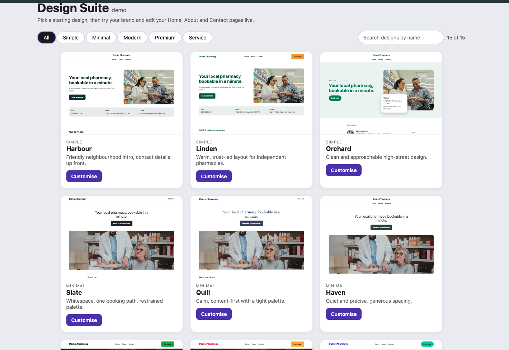

# Theme Suite demo
Proof of the v2 theme-template plan (`v2-pharmacy-theme-templates-plan.pdf`). No build, no deps.

    cd theme-suite-demo && python3 -m http.server 5173   # open http://localhost:5173

## Features
- **Gallery:** 15 designs, category filter, search, live thumbnails, shortlist (heart) with an enquiry email, measured Lighthouse scores per design
- **Customiser:** brand presets, colour pickers with WCAG AA check/auto-fix, 7 font presets, corner presets
- **Switch design:** change layout from the customiser and keep brand, logo and content
- **Light / dark mode:** surface and text tokens switch, brand text is lightened to stay AA on dark
- **Accessibility report:** 5 colour pairings checked live, one-click fix for the CTA label
- **Logo upload:** shown in header/footer, and primary/accent are picked from it
- **Content editor:** Home (headline, section toggles + order), About, Contact
- **Share / export:** copy a share link (logo not included), print or save a branded PDF spec, download or copy JSON, "Book a demo" email

## Files
- `theme.js`     token contract, font + radius presets, WCAG AA check/auto-fix (§5.1)
- `base.css`     shared styles; hover/light/dark derived from primary+accent via `color-mix()`
- `templates.js` 15 designs as slot→variant maps, variant components, default content/services (§5.2)
- `template.html` the "demo app": renders one design + page, applies CSS vars and content posted from the shell (§5.4). `?theme=1` applies the design's own brand
- `tools.js`     logo resize + colour pick, share-link encode/decode, printable spec sheet
- `index.html`   the shell: gallery and per-design customiser
- `scripts/measure.mjs` runs Lighthouse over every design and writes `scores.json`

## Set before going live
- `LEAD_TO` in `index.html`: sales email for "Book a demo" and the shortlist. Empty means the email draft has no recipient.
- Edits are saved in the browser only; the share link carries everything except the logo.

Port to v2: theme.js/base.css tokens -> `app/globals.scss` + `themes/*.css`; templates.js maps -> `@healthya-team/pharmacy-themes`
variant props; the shell's state -> Sanity `siteTheme` doc.
